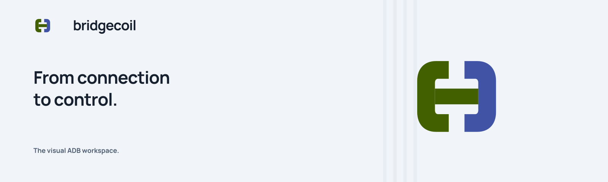
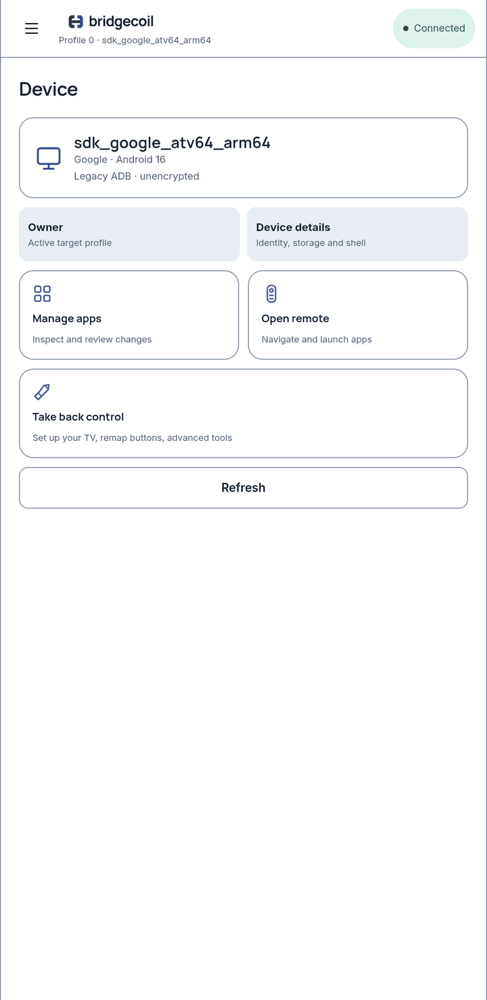
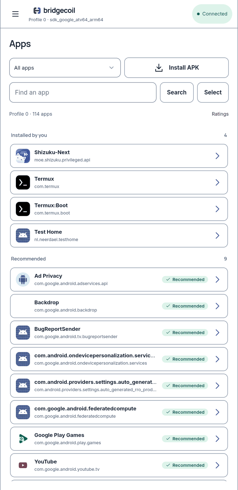
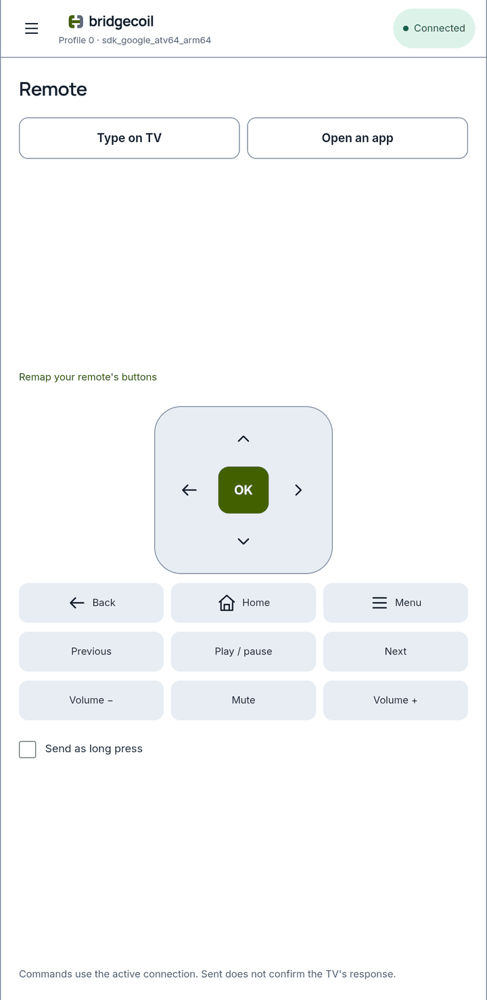
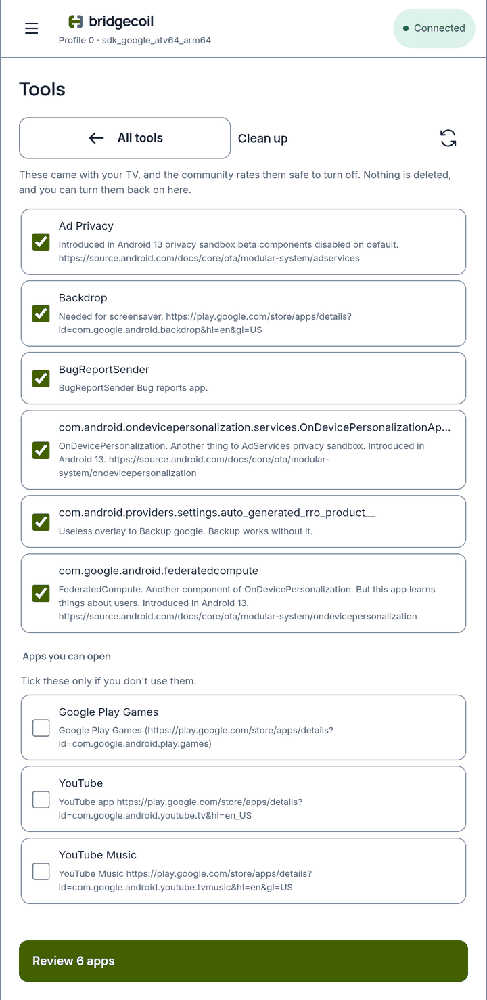
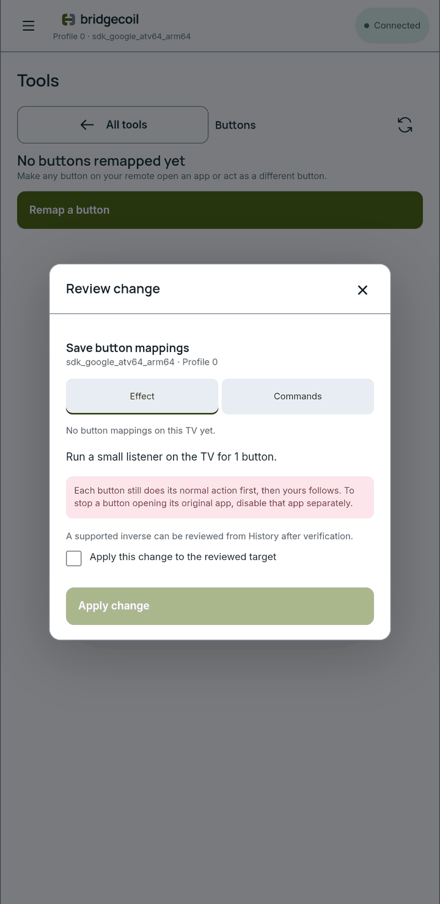
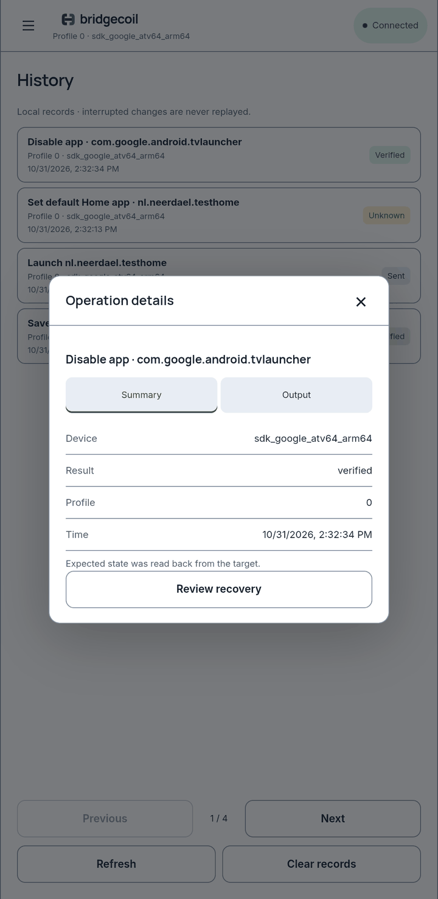

<p align="center">
  <picture>
    <source media="(prefers-color-scheme: dark)" srcset="site/assets/marketing/bridgecoil-readme-dark.png">
    
  </picture>
</p>

<p align="center">
  <a href="https://johnneerdael.github.io/bridgecoil/"></a>
  <a href="https://github.com/johnneerdael/bridgecoil/actions/workflows/pages.yml"></a>
  <a href="https://github.com/johnneerdael/bridgecoil/releases"></a>
  
</p>

Bridgecoil is a visual ADB workspace for your Android TV. Manage installed apps, choose a Home screen, remap remote buttons and reach deeper tools without learning ADB commands. Changes show the target, the expected effect and the result, with recovery where the operation supports it.

Bridgecoil connects directly over local wireless debugging. The supported wireless setup needs no computer, root or desktop ADB server.

<p align="center">
  <a href="https://github.com/johnneerdael/bridgecoil/releases"><b>Releases</b></a> &nbsp;·&nbsp;
  <a href="https://johnneerdael.github.io/bridgecoil/guide/"><b>Get started</b></a> &nbsp;·&nbsp;
  <a href="https://johnneerdael.github.io/bridgecoil/"><b>Website</b></a> &nbsp;·&nbsp;
  <a href="https://github.com/johnneerdael/bridgecoil/issues"><b>Report an issue</b></a>
</p>

## What you can do

| Task | How Bridgecoil helps |
| --- | --- |
| **Manage apps** | Browse installed packages, inspect community removal ratings and review changes for the selected device/profile. Unknown packages stay unknown. |
| **Choose a launcher** | Try a new Home app, set it as default and check the real Home button before disabling the old launcher. Keep a recovery path available. |
| **Remap your remote** | Learn a physical button and choose an app or another key as its action. Tap and hold behavior depends on the available input path. |
| **Prepare the TV** | Guided setup installs and starts the helper tools needed by the TV-side listener, checks each stage and tracks reboot verification separately. |
| **Work with files** | Browse TV storage, upload, save to your phone, rename, move and delete. |
| **Capture and diagnose** | Save screenshots and short recordings, inspect filtered logs and run explained commands. |
| **Use everyday controls** | Navigate with the on-screen remote, open app shortcuts and reach common settings. |
| **Review what happened** | Per-device history keeps requested changes, verified results and supported recovery actions visible. |

Community package descriptions and ratings come from [Universal Android Debloater](https://github.com/Universal-Debloater-Alliance/universal-android-debloater-next-generation). They provide context, not a guarantee that disabling an app is safe on your firmware.

## Screenshots

Captured from the signed **v0.1.7** build on a phone emulator connected to an **Android TV 16 emulator**, in the light theme.

<table>
  <tr>
    <td width="33%" align="center"><a href="docs/guide/screenshots/device.png"></a><br><sub><b>Device.</b> The selected TV and profile.</sub></td>
    <td width="33%" align="center"><a href="docs/guide/screenshots/apps.png"></a><br><sub><b>Apps.</b> Installed packages and community ratings.</sub></td>
    <td width="33%" align="center"><a href="docs/guide/screenshots/remote.png"></a><br><sub><b>Remote.</b> Navigation and media controls.</sub></td>
  </tr>
  <tr>
    <td width="33%" align="center"><a href="docs/guide/screenshots/clean-up.png"></a><br><sub><b>Clean up.</b> Review which apps to turn off.</sub></td>
    <td width="33%" align="center"><a href="docs/guide/screenshots/buttons-review.png"></a><br><sub><b>Button mapping.</b> See the effect and original-action warning.</sub></td>
    <td width="33%" align="center"><a href="docs/guide/screenshots/history-record.png"></a><br><sub><b>History.</b> Verified results and available recovery.</sub></td>
  </tr>
</table>

[Browse all 51 screenshots with captions](https://johnneerdael.github.io/bridgecoil/screenshots.html) · [Walk through the user guide](https://johnneerdael.github.io/bridgecoil/guide/)

## Get Bridgecoil

Check [GitHub Releases](https://github.com/johnneerdael/bridgecoil/releases) for available builds and the notes for each one. The current release pipeline produces these files:

| Controller | Distribution | Status |
| --- | --- | --- |
| **Android phone, arm64** | `Bridgecoil-<version>-arm64.apk` and `SHA256SUMS` | Signed APK from the release workflow. Install on the phone. |
| **iPhone / iPad** | [TestFlight beta delivery](docs/ios-beta.md) | Each release automatically builds and uploads the same version after Android publishes. Check the release run's iOS job; Apple processing/review and tester access follow separately. Physical-iPhone acceptance is pending. |
| **macOS / Windows / Linux** | Build from source | No public desktop packages in the current release workflow. |

Releases use one Android signing identity so compatible builds can update an existing installation. See [release and signing details](docs/release.md). Do not infer platform availability from a design preview.

## First connection

1. Install an available Android arm64 APK on your phone.
2. Connect the phone and TV to the same local network. Keep **Wi-Fi enabled on the TV**; Wireless debugging may turn off on a wired-only connection.
3. On the TV, open **Settings → System → About** and repeatedly select **Android TV OS build** to unlock Developer options. Menu names vary by manufacturer.
4. Enable **Wireless debugging** and open its pairing-code screen.
5. Open Bridgecoil, select the TV and enter the code it shows. Pairing establishes trust; connecting to the TV is a separate step. Confirm the selected device and profile before changing anything.

Follow the [connection guide](https://johnneerdael.github.io/bridgecoil/guide/get-started/first-connection/) for more context.

## Guided TV setup

Persistent remote mappings need an execution helper and a listener on the TV. Bridgecoil guides the setup; basic app management and ordinary remote controls do not require the full toolkit.

1. Choose [Shizuku-Next](https://github.com/rushiranpise/Shizuku-Next) or [Porter](https://github.com/d4rken-org/porter). Bridgecoil downloads the release, checks its expected signing certificate and installs it.
2. Start the helper over the same connection.
3. Install [Termux](https://github.com/termux/termux-app) and Termux:Boot through the guided flow.
4. Connect Termux to the helper and approve its prompt on the TV.
5. Enable helper startup at boot and let Bridgecoil prepare the startup script. Test the physical button, phone-independent operation and restart behavior separately.

Play Protect may stop the Termux apps because of their older Android target. Read the TV prompt and decide there whether to continue. Bridgecoil does not turn Play Protect off. A package signed by an unexpected developer is refused. See [prepare the TV toolkit](https://johnneerdael.github.io/bridgecoil/guide/get-started/set-up-your-tv/).

## Compatibility and current limits

Guided setup has run end to end on an **Android TV 16 emulator**, using secure ADB with no root. **Physical-TV setup validation is still pending.** Real firmware, permissions and input paths vary.

- A remapped button can still perform its original action before the new one. The current non-root listener cannot universally suppress that action.
- Power, voice and some vendor buttons never reach the accessible input path.
- On wired-only TVs, automatic helper startup may fail after a restart. Enable Wi-Fi or start the helper again from Bridgecoil.
- Some TVs restrict the access Termux needs; reboot persistence needs its own check on the target TV.
- Android keeps a connection service running while connected. On iPhone and iPad, leaving the app can drop the connection; reconnect when returning.
- Protected streaming surfaces usually appear black in screenshots and recordings.
- Shizuku-Next cannot replace an app with the same package name and a different signer. Porter can sit alongside it.
- Recovery exists only for supported operations. Reinstalling a package does not restore deleted app data.

Read [compatibility and limits](https://johnneerdael.github.io/bridgecoil/guide/help/not-available-yet/) and the individual build's release notes before relying on a workflow.

## Documentation

- [User guide](https://johnneerdael.github.io/bridgecoil/guide/): connection, apps, launchers, remotes, toolkit, files and recovery.
- [Screen guide](docs/guide/README.md): screenshots of each part of the app, step by step.
- [Website maintenance](docs/website.md): local preview, Pages deployment, brand assets and screenshot handoff.
- [Release process](docs/release.md): signing, version tags and branded release notes.

## Development

A Tauri 2 app with a Rust core in `crates/adb-core` and a Svelte 5 interface. ADB is spoken directly through [libadb](https://docs.rs/libadb).

Requires Node 22, Rust through rustup and each platform's toolchain.

```sh
npm ci
npm run check
npx vitest run
node scripts/cargo.mjs test --workspace
npm run dev
```

`npm run dev` shows the interface in a browser, where native features are marked unavailable.

```sh
npm run android -- build --debug --target aarch64 --apk --ci   # Android, needs ANDROID_HOME, NDK_HOME and JAVA_HOME
npm run ios -- build --debug --target aarch64-sim --no-sign --ci   # iOS simulator, needs Xcode, XcodeGen and CocoaPods
npm run build:desktop   # macOS
```

`crates/adb-core/tests/toolkit_live.rs` walks the whole setup on a disposable emulator. Run it by hand, and only against an emulator, because it installs and removes apps. See the header of that file.

Releases are described in [docs/release.md](docs/release.md).

For iPhone/iPad builds, signing prerequisites and the physical-device acceptance checklist, see [iOS beta / TestFlight](docs/ios-beta.md). A successful archive is build evidence; current iOS runtime acceptance is still pending.
