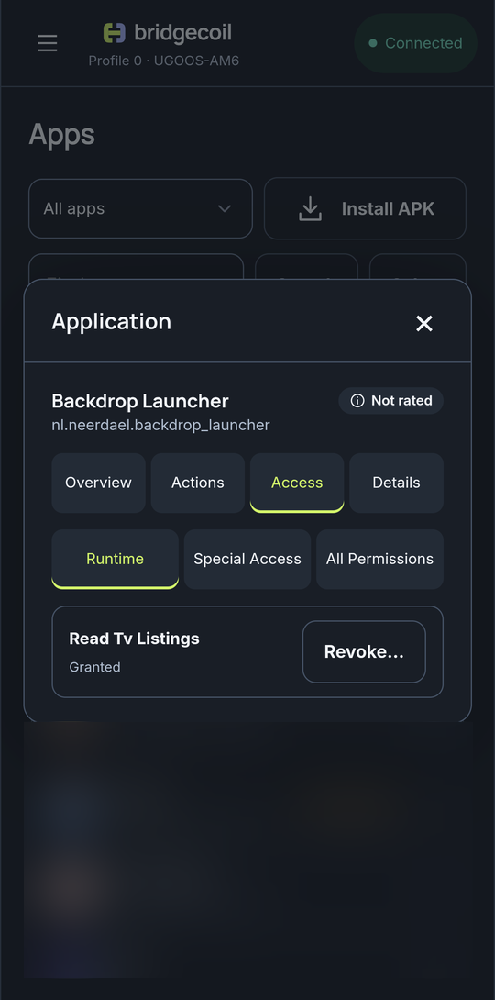

# Control what an app can access

A TV has no good screen for this. The **Access** tab on an app shows what it can do and lets you change it.

Open an app and tap **Access**. It has three tabs.

{ .bc-shot loading=lazy }

## Runtime

These are the permissions Android normally asks about, such as the microphone or storage. Each shows **Granted** or **Not granted**, with **Revoke…** or **Grant…** to change it. Revoking can stop an app working properly until you grant it again. Android can refuse a change, and system rules can override it.

## Special access

These are stored Android policies. Each row shows the stored value, and the dropdown changes it to **Android default**, **Allow**, **Ignore requests**, **Deny** or **Foreground only**.

| Policy | What it controls |
|---|---|
| **Display over other apps** | Whether the app can draw on top of what you're watching |
| **Modify system settings** | Whether it can change settings such as brightness |
| **Usage access** | Whether it can see which apps you use |
| **Run in background** | Whether it can keep running when you're not using it |
| **Background restrictions** | Whether Android limits its background activity |

Bridgecoil reads the stored policy back to check the change. Other permissions and firmware can still limit what really happens. **Unavailable on this TV** means the TV doesn't report that policy.

Choosing a value opens a review right away, and closing that review returns you to the Apps page.

## All permissions

A read-only list of everything the app declares and whether it's granted. If Bridgecoil can't read runtime access, this list still works.

Both kinds of change can be undone from [History](../history/index.md).
