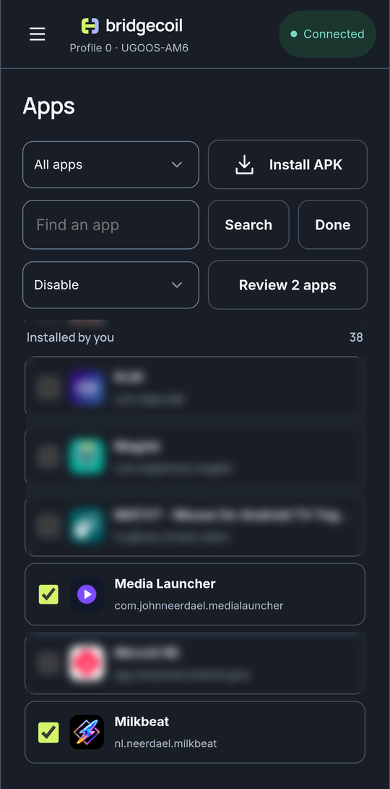
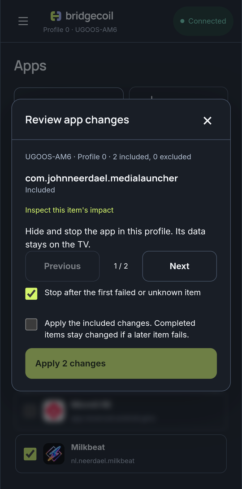

# Change many apps at once

Select mode applies one action to up to 32 apps.

1. On the Apps page, tap **Select**. Rows turn into checkboxes.
2. Tick the apps you want. There's no select all, and nothing is ticked for you.
3. Choose an action from the dropdown. **Disable** is the default.
4. Tap **Review**, then go through the apps one at a time.
5. Tick the box to apply, then tap **Apply**.

{ .bc-shot loading=lazy }

{ .bc-shot loading=lazy }

The review shows each app as **Included** or **Excluded · will not run**. An app is left out, with the reason, if it's rated Unsafe, it's protected, it's your launcher, or the TV didn't report its state. **Inspect this item's impact** shows what the change does to that app.

**Stop after the first failed or unknown item** is on by default. Leave it on, so a problem doesn't carry on through the list.

Changes apply one at a time, and those already done stay done if a later one fails. **Cancel remaining items** stops after the current app.

## Read the result

| Result | Meaning |
|---|---|
| **Done** | Checked on the TV |
| **Sent** | The command ran, and the effect couldn't be checked |
| **Not run** | It wasn't reached |
| **Failed** | It didn't work |
| **Partly done** | Some of it worked |
| **Unconfirmed** | Bridgecoil couldn't tell |
| **Left out** | It was excluded, with the reason |

Each app gets its own row in [History](../history/index.md), so you can undo them one at a time.
