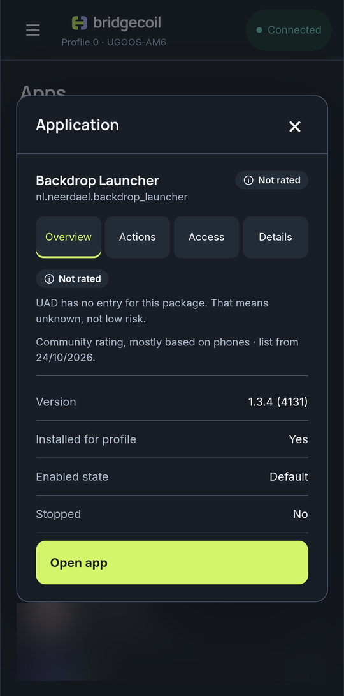

# Check what an app does and whether it's safe to remove

Package names like `com.tcl.guard` tell you very little. Ratings show what an app is for and how risky it is to remove.

Ratings come from the Universal Android Debloater list, a community project. Bridgecoil downloads the list from GitHub only if you ask. The first time you open Apps, a **Get community ratings** card offers it. Tap **Download**, or **Not now** to hide the card.

!!! screenshot "apps-ratings-card.png"
    The Get community ratings card on the Apps page.

## What the levels mean

| Level | Meaning |
|---|---|
| **Recommended** | Pointless on most devices, or easy to get back from Google Play |
| **Advanced** | May break minor features, or has a better replacement |
| **Expert** | Breaks important features. Removing it shouldn't stop the device starting, but that isn't guaranteed |
| **Unsafe** | Can break vital parts of Android and may stop the device starting |
| **Not rated** | The list has no rating for this. That means unknown, not low risk |

Apps you installed yourself appear under **Installed by you**, whatever their rating.

## Read an app's rating

Open an app. **Overview** shows its rating, a description and where the description came from. **Needs** lists what it depends on and **Needed by** lists what depends on it, with **· On this TV** next to packages your TV really has. **None listed** means the community list names none, and an empty list doesn't prove there are none.

{ .bc-shot loading=lazy }

## Trust it with care

The list is written by volunteers and is mostly based on phones. A TV can depend on something a phone doesn't, and a brand's own apps often have no entry at all. Turning an app off is reversible, so when you're unsure, [disable it rather than remove it](turn-off-or-remove-an-app.md) and use the TV for a few days.

## How Unsafe apps are protected

For an Unsafe app, **Disable**, **Remove from profile** and **Clear app data** are hidden. **Show these actions anyway** reveals them for that one visit to the app. Bulk changes and undo can't get around this block, so an Unsafe app is always left out of a bulk change.

## Keep the list up to date

Tap **Ratings** on the Apps page to see how many packages the list has and its date. **Check for update** looks for a newer list, and **Remove ratings** deletes it from your phone straight away, along with the badges and the Unsafe protection.

With a list saved, Bridgecoil checks GitHub for updates at most once a day when you open Apps. If an update looks wrong, it keeps the list you have.
