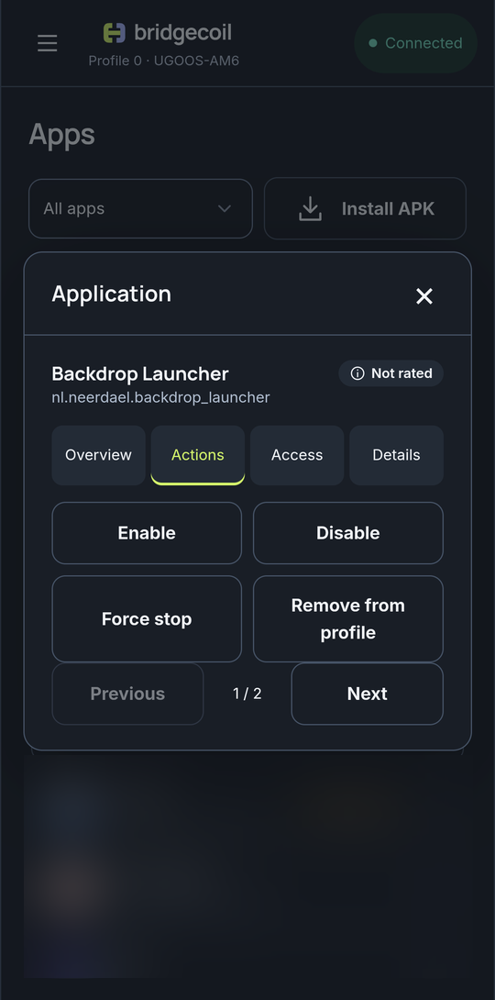
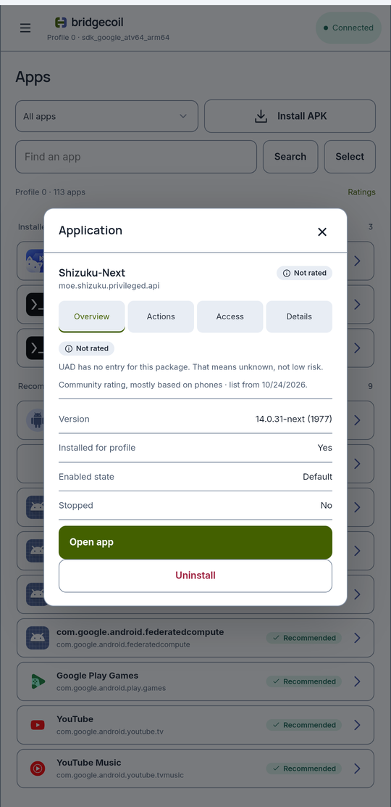

# Turn off, stop or remove an app

Open an app and go to **Actions**. Each action opens a review first, so you can read what it does before anything happens.

{ .bc-shot loading=lazy }

## Read an app's state

**Overview** shows the facts behind these actions:

| Field | Meaning |
|---|---|
| **Version** | The version name and number, or **Not reported** |
| **Installed for profile** | Whether this profile has the app |
| **Enabled state** | **Default**, **Enabled** or **Disabled for profile** |
| **Stopped** | **Yes** if the app has been force stopped or has never run |

## Which action do you want?

| You want to | Use | Can you undo it? |
|---|---|---|
| Stop an app without losing anything | **Disable** | Yes, from History or with **Enable** |
| Turn a disabled app back on | **Enable** | Yes |
| Return to the app's normal state | **Default enabled state** | Yes |
| Close an app that's stuck or playing | **Force stop** | It starts again when opened |
| Delete an app you added | **Uninstall** | No. Install it again, and its data is gone |
| Hide an app that came with the TV from this profile | **Remove from profile** | Only the app comes back, and its data is gone |
| Bring back a removed app | **Restore existing package** | Deleted data isn't restored |
| Free up cache space | **Clear cache** | Android rebuilds cache as needed |
| Reset an app completely | **Clear app data** | No |

Disable is the one to reach for first. It hides the app and stops it running, and its data stays on the TV.

## What each one does

**Disable** hides and stops the app in this profile. Its data stays on the TV.

**Enable** allows the app to run again.

**Default enabled state** lets the app go back to whatever state it had from the factory.

**Force stop** ends the app and anything it was playing or doing in the background. It can start again later.

**Uninstall** deletes an app you added from the TV completely, for every profile, along with its data. It's on the app's **Overview** tab, under **Open app**, and at the top of **Actions**. Apps that came with the TV don't have it, because Android won't uninstall them. The result only says **Verified** once the app is gone. Uninstalling Termux or Termux:Boot stops your button mappings, and the review tells you so.

{ .bc-shot loading=lazy }

**Remove from profile** is for apps that came with the TV. It deletes the app for the selected profile, and its data with it. Android keeps the app itself on the TV, so **Restore existing package** can bring it back. Apps you added show **Uninstall** in its place.

**Clear cache** asks Android to clear the app's temporary files. Older firmware may not support this.

**Clear app data** resets the app, including sign-ins, settings and downloads. This can't be undone.

## What Bridgecoil refuses to do

Some changes would leave a TV in a bad state, so **Disable**, **Remove from profile**, **Uninstall** and **Clear app data** are blocked for:

- Core parts of Android, including Settings and the system interface. You'll see "This system component is protected from this operation."
- The launcher in use, unless another one is ready. You'll see "Choose and verify a replacement Home app before changing the active launcher."

To change launchers, use [Replace your home screen](../home-screen/replace-your-launcher.md).

## After a change

The result shows **Verified** if Bridgecoil read the new state back from the TV. **Sent** means the command ran and the effect couldn't be checked. Clear cache and Clear app data always show Sent. See [What the results mean](../history/reviews.md#what-the-results-mean).

An app changed here stays changed after a restart, so you don't need [TV setup](../get-started/set-up-your-tv.md) for this.
