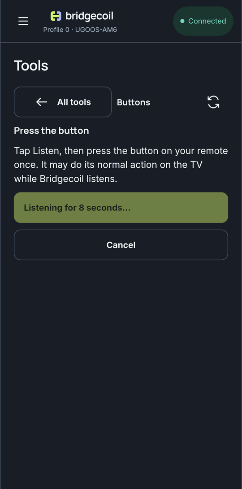
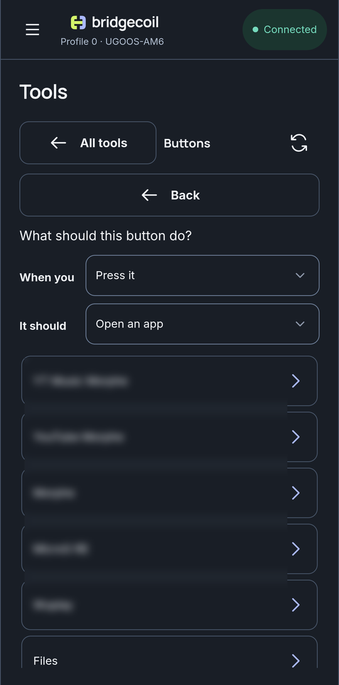
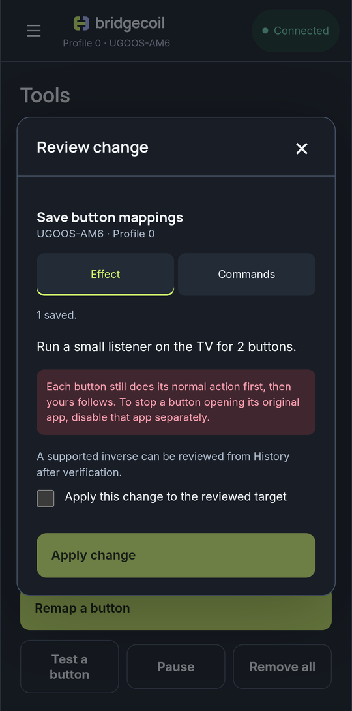

# Make a button open the app you want

Turn the button that opens an app you never use into a shortcut to one you do. This takes about two minutes.

1. Open **Tools → Buttons** and tap **Remap a button**.
2. Tap **Listen**, then press the button on your remote once. You have 8 seconds. It may do its normal action on the TV.
3. Tap your button in the list.
4. Under **When you**, keep **Press it**. Under **It should**, keep **Open an app**, then tap the app.
5. Read the review and apply it.

!!! screenshot "buttons-empty.png"
    Buttons with No buttons remapped yet and Remap a button.

{ .bc-shot loading=lazy }

{ .bc-shot loading=lazy }

{ .bc-shot loading=lazy }

The review says: "Each button still does its normal action first, then yours follows." If the button used to open an app, Bridgecoil offers to deal with that next. See [Replace what a button opens](replace-what-a-button-opens.md).

## What you see in the list

Each mapped button shows what it does, then the key, its code and the remote it came from. **Hold** is added for a hold mapping.

## Make a button act as another button

Choose **Act as a different button** under **It should**, then pick one: **Home**, **Back**, **Menu**, **Volume up**, **Volume down**, **Mute**, **Play or pause**, **Next track**, **Previous track**, **Stop**, **Rewind**, **Fast forward**, **Channel up**, **Channel down**, **Switch input**, **Subtitles**, **Settings**, **Search** or **Turn the screen off**.

A remote with no input button can get one this way, for example by mapping a streaming button to **Switch input**.

## Change a mapping

Map the same button again. Bridgecoil tells you what it does now, with "Right now this opens {app}." Choosing something else replaces the old mapping, so you never end up with two actions for one press.

## If nothing is found

"Nothing reached Bridgecoil." means no input event arrived in those 8 seconds. Try again and press firmly. See [Which buttons can be remapped](which-buttons.md).
