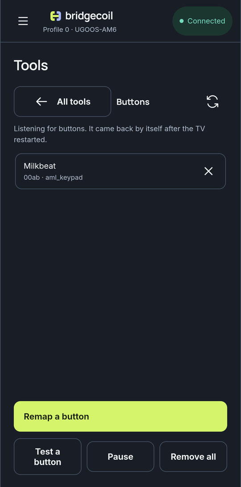

# Test, pause or remove your mappings

Check that a mapping works, switch all of them off for a while, or get rid of them.

{ .bc-shot loading=lazy }

## See what's happening

The line at the top of Buttons tells you the state:

| Line | Meaning |
|---|---|
| **Listening for buttons on the TV.** | Working |
| **Listening for buttons. It came back by itself after the TV restarted.** | Working, and it's proven to survive a restart |
| **Paused. Buttons do their normal action only.** | Switched off for now |
| **The listener isn't running on the TV.** | Tap **Start it again** |

**Mappings only stay running after setup is finished.** means you haven't finished TV setup. **Finish TV setup** takes you there.

## Test a button

Tap **Test a button** to open **Test your button**, press a mapped button on your remote, come back and tap **I pressed it**. **Done** closes it.

| Result | Meaning |
|---|---|
| "It worked: {label} opened." | Everything's fine |
| "The TV saw the press but couldn't open {label}." | The app may be gone or turned off |
| "The TV didn't see a press of a mapped button." | The listener didn't match it. Map the button again, and check that it's running |

## Pause

**Pause** stops all mappings without removing them, so buttons do their normal action only. **Resume** turns them back on. This is useful if a family member wants the original buttons for a while. The listener keeps running while paused.

## Remove one or all

Tap the remove icon on a row to remove one mapping. **Remove all** deletes every mapping on the TV and everything in Bridgecoil's folder there, and it can't be undone. Saving a mapping can be undone from [History](../history/undo-a-change.md), but Pause and Remove all can't.

You can have up to 64 mappings.
