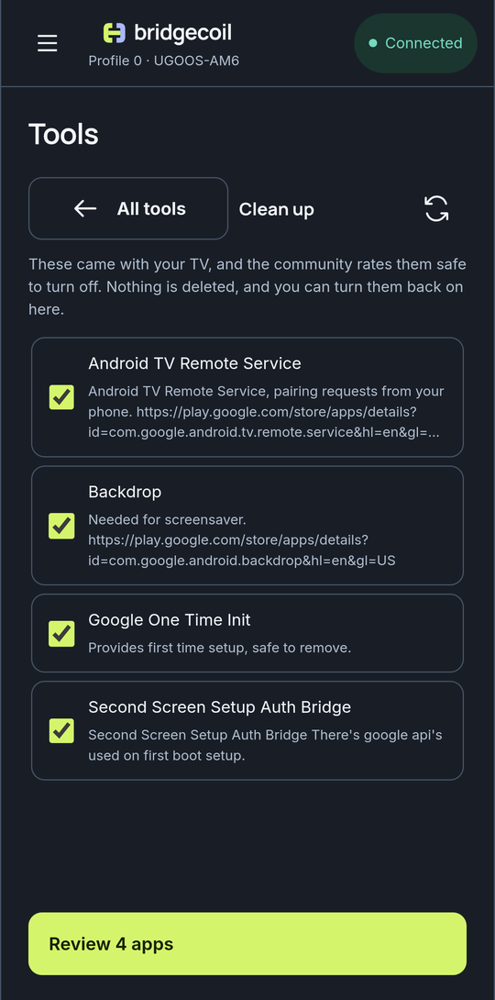

# Clean up your TV

Clean up turns apps off without deleting them, so you can reverse everything it does.

1. Open **Tools → Clean up**.
2. The first time, you'll see **Find what's safe to turn off**. Tap **Download ratings**, which is a small download from GitHub.
3. Read the list. Apps with no icon on your home screen are ticked for you. Apps under **Apps you can open** aren't, because you might use them.
4. Tick or untick what you want.
5. Tap **Review**, go through the apps, tick the box to apply and tap **Apply**.

{ .bc-shot loading=lazy }

!!! screenshot "cleanup-result.png"
    Operation result listing Done for each app.

The list only shows system apps that the [community list](../apps/ratings.md) rates **Recommended** and that aren't already off. Nothing is deleted. Each app is disabled, with its data left on the TV.

## How much at once

A review handles up to 32 apps. If you've chosen more, Bridgecoil says "{n} more can follow once these are done."

Take it in stages on a TV you rely on. Turn off a batch, use the TV for a day, then do the next. If something stops working, it's much easier to work out which app did it.

## Will the apps come back?

Disabled apps stay off through restarts, so this needs no [TV setup](../get-started/set-up-your-tv.md). A TV-brand system update can sometimes turn things back on.

Some apps stop the TV doing something you didn't connect with them, such as voice search or casting. Read the description, and [bring them back](bring-apps-back.md) if you miss something.

When there's nothing left, you'll see **Nothing left to clean up**. Other apps are in [Apps](../apps/browse-and-search.md) with what's known about each.
