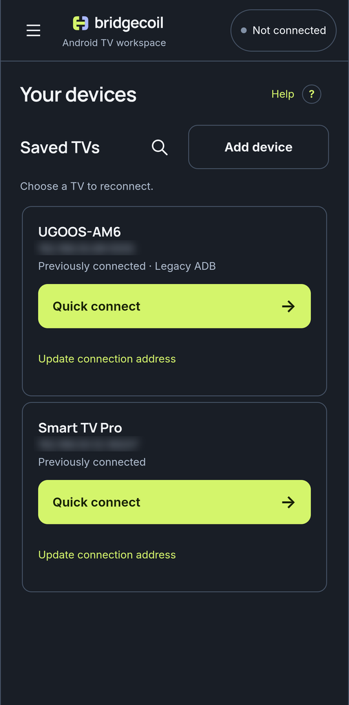
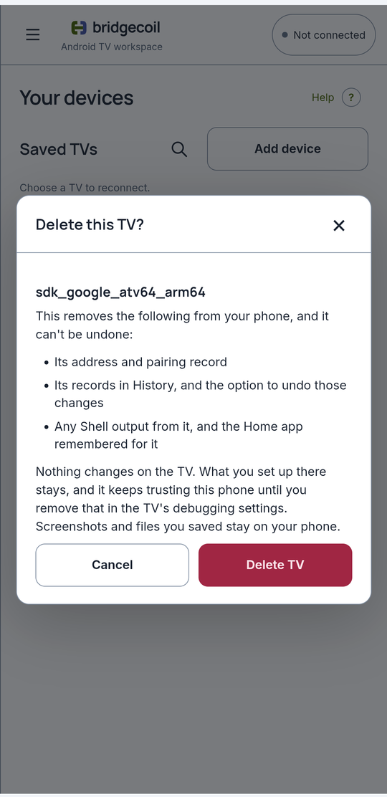

# Reconnect to a saved TV

Every TV you pair is saved on your phone, so you can come back to it with one tap.

Open Bridgecoil while you're not connected and you see **Saved TVs**. Each row shows the TV's name, its address and its status: **Previously connected**, or **Paired · connection address needed** if you paired but never connected. **Legacy ADB** is added for a TV that uses the older connection.

{ .bc-shot loading=lazy }

## Quick connect

Tap **Quick connect →**. Bridgecoil scans your network for a few seconds to find the TV's current port, connects, and checks that the TV is the one you saved. If the scan can't run, it tries the saved address.

| What you see | What it means | What to do |
|---|---|---|
| "No connection port was found for this paired TV." | Wireless debugging is off, or the TV isn't on this network | Turn it on, or enter the address from the main Wireless debugging screen |
| "That address belongs to a different device." | Another TV now has this address | Use **Update connection address** |
| The connection form with an error | Quick connect couldn't finish | Read the error, or use **← Saved devices** to go back |

## Wake a sleeping TV

Quick connect also sends a Wake-on-LAN message, which asks a sleeping TV to wake up. If the TV doesn't answer straight away, Bridgecoil shows **Waking TV** and tries a few more times before giving up. A TV that's already on connects as quickly as before.

Whether a TV wakes depends on the TV. Many switch off their network completely when they sleep, or only listen on a network cable, so this doesn't work on every model. Look for a setting like *Wake on LAN*, *Wake on Wi-Fi* or *Network standby* in the TV's settings, and turn it on if it's there.

Bridgecoil learns the addresses it needs while the TV is connected, so connect once after updating the app. **Delete** removes them along with the rest of the saved TV.

## Add another TV

Tap **Add device** and follow [Connect your phone to the TV](../get-started/first-connection.md). You can save up to 32 TVs, and only one is connected at a time.

## Rename a saved TV

Tap **Rename** on the TV's row and type a name, such as *Living room*. Bridgecoil keeps your name when it reconnects or the TV's address changes. Clear the name to go back to the TV's own.

## Delete a saved TV

Use this when you've finished with a TV, such as one that belongs to someone else. Disconnect first, because Saved TVs only shows while you're not connected.

1. Tap **Delete** on the TV's row.
2. Read the warning, which lists what goes.
3. Tap **Delete TV**. **Cancel** leaves everything as it was.

{ .bc-shot loading=lazy }

| Removed from your phone | Stays where it is |
|---|---|
| The TV's address and pairing record | Everything on the TV, including apps, mappings and Termux |
| Its records in History, and the option to undo those changes | The TV's trust in your phone |
| Shell output from it, and the Home app remembered for it | Screenshots, recordings and files you saved |

This can't be undone. Your other saved TVs, their History records and your saved commands aren't touched.

The TV still trusts your phone afterwards, so you can add it again without a new pairing code. To end that, remove your phone in the TV's debugging settings. See [Taking away access](../how-it-works/privacy.md#taking-away-access).

If a TV never gave Bridgecoil a stable ID, its History records can't be matched to it, so they stay. The warning says so when this applies, and **Clear records** in History removes them.

## Limits

Bridgecoil doesn't connect by itself when it opens.
