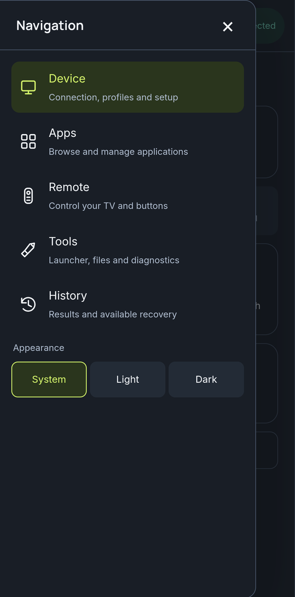
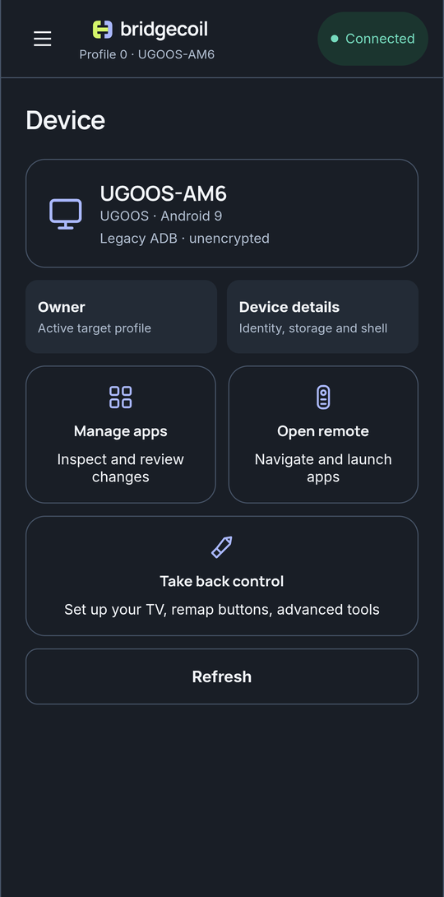

# Find your way around the app

Bridgecoil has five main sections, and most changes go through the same review step.

Tap the menu icon at the top left to open **Navigation**.

| Section | What it's for |
|---|---|
| **Device** | Connection, profiles and setup |
| **Apps** | Browse and manage applications |
| **Remote** | Control your TV and buttons |
| **Tools** | Launcher, files and diagnostics |
| **History** | Results and available recovery |

{ .bc-shot loading=lazy }

## The Device page

This is your home screen once you're connected. The card at the top shows the TV's model, brand, Android version and whether the connection is encrypted.

| Tile | What it does |
|---|---|
| Profile tile | Chooses which [TV profile](../apps/profiles.md) app changes apply to |
| **Device details** | Shows identity, storage and shell information |
| **Manage apps** | Goes to Apps |
| **Open remote** | Goes to Remote |
| **Take back control** | Goes to Tools, for setup, button remapping and advanced tools |
| **Refresh** | Reads the TV's details again |

{ .bc-shot loading=lazy }

**Device details** lists the model, manufacturer, Android and SDK version, processor type, address, serial, build, the shell identity, storage and how long the TV has been on. It's useful when someone asks which TV you have.

## The connection badge

The badge at the top right shows **Connected**, **Not connected**, **Working…** or **Starting…**. Tap it while connected to open **Device connection**, which shows the **Address**, the **Transport** (TLS, or Legacy · unencrypted), the **Android** version and the **Profile**. **Disconnect** there acts straight away. Disconnecting doesn't remove your phone's permission on the TV, so you can reconnect without pairing again.

## When you're not connected

Apps, Remote and Tools show **Connect your device** until you connect, with **Open connection setup**. History still works.

## How changes work

Most changes open a review first. The review shows what will happen, what you could lose and, on the **Commands** tab, the exact command that will run. It runs only when you tick the box and tap **Apply change**. [How a change is reviewed and undone](../history/reviews.md) has the details, including what skips the review.

## Light and dark

The drawer has an **Appearance** setting with **System**, **Light** and **Dark**. System follows your phone.
