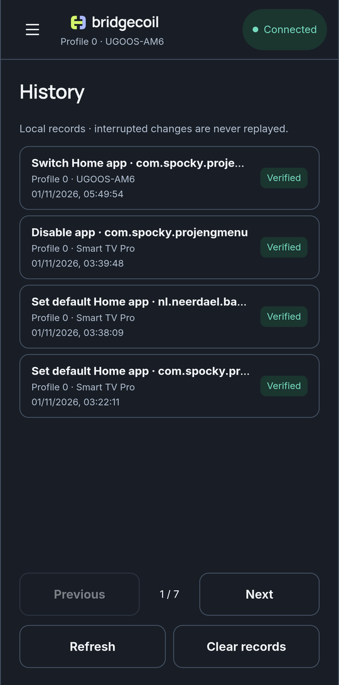
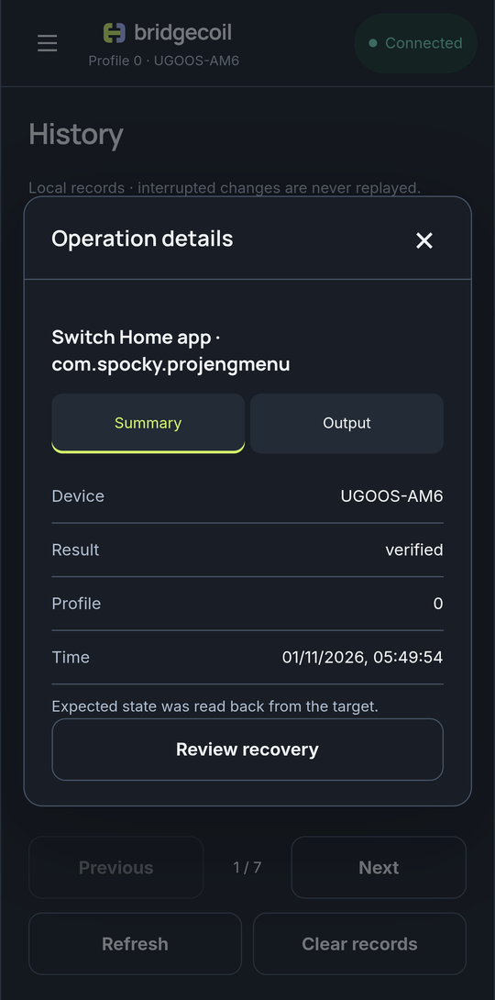

# History and undo

History is your record of what Bridgecoil did, kept on your phone. It works even when you're not connected.

- [How a change is reviewed and undone](reviews.md)
- [Undo a change](undo-a-change.md)

Rows are newest first. Each shows the title, profile, TV, time and result. Tap one to open **Operation details**, where **Summary** explains the result and **Output** shows what the TV said.

{ .bc-shot loading=lazy }

{ .bc-shot loading=lazy }

Pairing, connecting, changing profile, ratings and APK installs aren't recorded here.

**Clear records** asks you to confirm with **Clear local records**, then removes all local records and every undo option. It changes nothing on the TV, and it can't be reversed. Output is capped at 64 KB per record.
