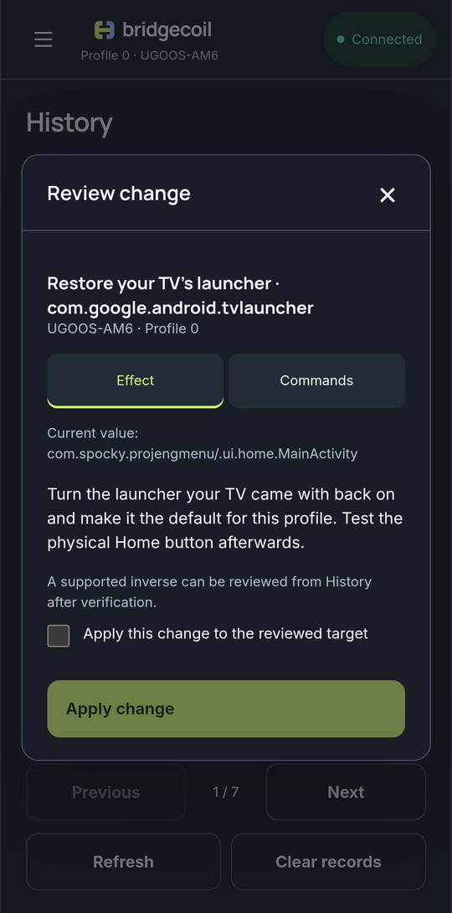
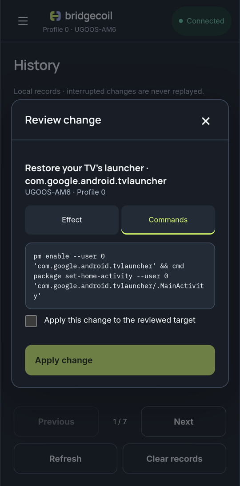

# How a change is reviewed and undone

Changes to apps, settings, launchers and files open a review, so you can read what will happen before it runs.

## The review

A review shows:

- The change, and which TV and profile it's for
- The current state
- What it does
- A warning box for anything you could lose
- Whether it can be undone
- On the **Commands** tab, the exact command that will run

Tick **Apply this change to the reviewed target**, then tap **Apply change**. The box starts unticked every time. To cancel, close the review.

{ .bc-shot loading=lazy }

{ .bc-shot loading=lazy }

## What skips the review

These run as soon as you tap them, or by themselves during setup:

| Action | Recorded in History? |
|---|---|
| **Install** and **Update** for Termux, Termux:Boot, Shizuku and launchers | No |
| **Install app** from a file, which has its own confirm box | No |
| Putting the agent into Termux, and replacing it after an app update | No |
| After pairing: background permissions, `boot.sh` and `00-bridgecoil` | No |
| **Try it** and **Open app**, which open an app | Yes |
| [Remote](../remote/use-your-phone-as-a-remote.md) presses and text | Yes |
| **Upload file** and **Save to this device** | No |
| Screenshots and recordings | No |
| **Listen**, which reads key presses for 8 seconds | No |
| [Shell](../tools/shell.md#what-runs-straight-away) commands that only read | Yes |

[What Bridgecoil installs on your TV](../how-it-works/what-gets-installed.md) explains the setup changes.

## Why a review can stop working

A review belongs to one TV, connection and profile, and lasts 10 minutes. Bridgecoil reads the state again just before applying. If it has changed, the change stops, so a stale review can't do something you didn't intend.

| Message | What to do |
|---|---|
| "This review expired. Inspect the current state again." | Start the action again |
| "The TV's state changed after review. Review the action again." | Something else changed the TV. Check and start again |
| "The device, connection or profile changed. Review this action again." | Reconnect and start again |

After a change, **Operation result** shows the outcome, and **View history** opens its record.

## What the results mean

| Result | Meaning |
|---|---|
| **Verified** | Bridgecoil read the expected state back from the TV |
| **Sent** | The command ran, and its effect couldn't be checked |
| **Partial** | Part of a bulk change worked |
| **Unknown** | Bridgecoil couldn't tell. Check the TV before trying again |
| **Failed** | It didn't work |
| **Cancelled** | It was stopped before running |

If Bridgecoil closes during a change, the record becomes Unknown. Bridgecoil never replays an interrupted change.
