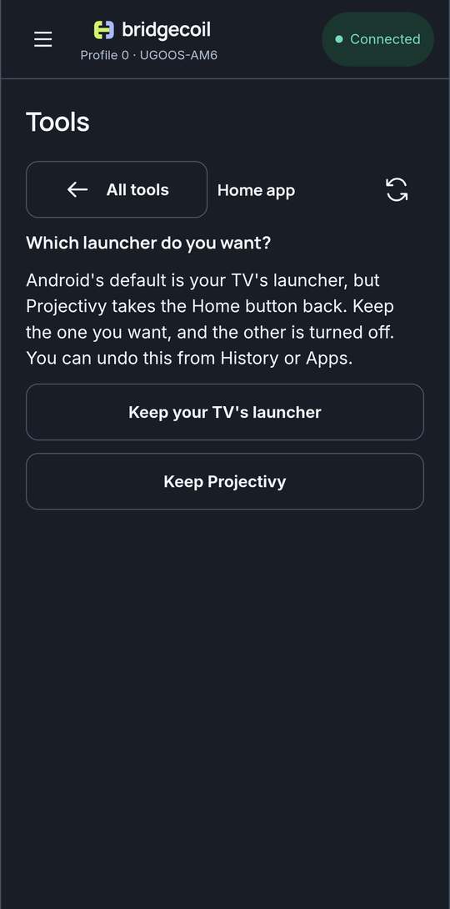

# If the Home button doesn't change

Android keeps a record of the default launcher, and other software can get in the way of it. Home app tells you which problem you've got.

## "Which launcher do you want?"

Android has one launcher as its default, while another takes the Home button back through its accessibility service. Projectivy's **Override current launcher** option does this. Bridgecoil can't know which one you want, so it asks before showing anything else.

{ .bc-shot loading=lazy }

 **Keep {name}** makes that launcher the default, opens it and turns the other one off, after a review. Your list of launchers appears once you've chosen.

If you use an override on purpose and want to leave things as they are, leave this screen without choosing, and nothing changes.

Turning a launcher off also clears its accessibility setting. If you turn it back on later, you'll have to turn that on again in the launcher's own settings.

## "Your TV's own launcher comes first"

Android TV launchers can have a higher priority than anything you install, so the TV ignores your choice. **Turn off {name}** hands Home to the launcher you chose. **Keep {name}** stays on the stock one.

## "Press Home on your remote"

Bridgecoil asks this once for a launcher you didn't choose in the app. Asking for a launcher doesn't prove the Home button uses it, so press Home and tell it what opened. **Home opened it** takes you to the list. **Home opened something else** shows what you can do.

## "This TV kept its own Home"

Some TVs don't let the Home button change. Use a button mapping as a way around it: [map a button](../buttons/remap-a-button.md) to open your launcher.

## "{package} is the default now, but {others} is still on."

The default changed, and a launcher couldn't be turned off. Find it in [Apps](../apps/turn-off-or-remove-an-app.md) and disable it.

## "Android accepted this choice, but Home still opens {package}."

Firmware can refuse the choice, show its own chooser or keep its launcher. Press Home on your remote in case the TV asks you.
