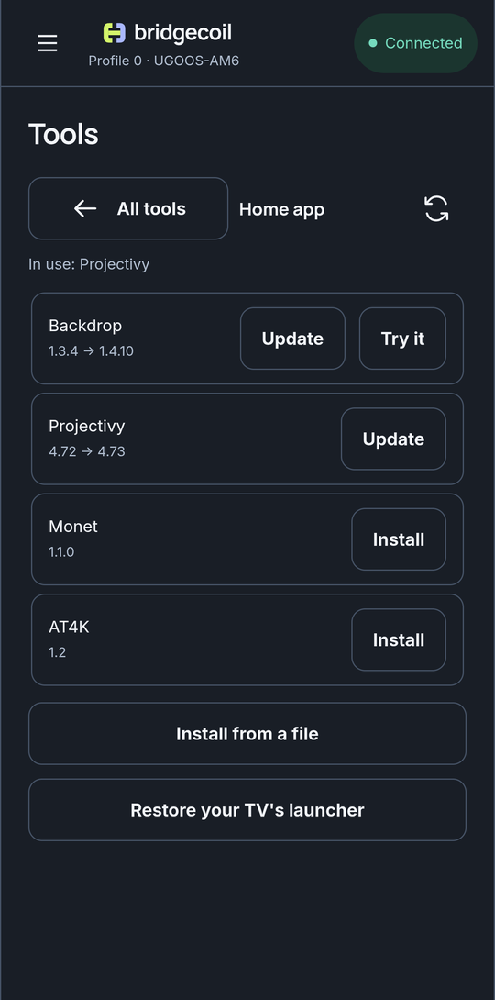

# Update a launcher

Home app checks for new versions each time you open it.

When a newer version is out, its row shows the change, such as `4.72 → 4.73`, with **Update** next to it. Tap it. Bridgecoil downloads, checks and installs it, and your settings stay in place.

{ .bc-shot loading=lazy }

If the launcher is in use, Android closes it during the update. Press Home on your remote to bring it back.

Nothing updates in the background, so an update only happens when you tap it.

## When there's no Update button

| The row shows | Meaning |
|---|---|
| A version number | You have the latest, or GitHub couldn't be reached |
| **Your own build** | It's signed by someone else, so a listed update can't replace it |
| **Installed** | The TV didn't report a version, so Bridgecoil won't guess |
