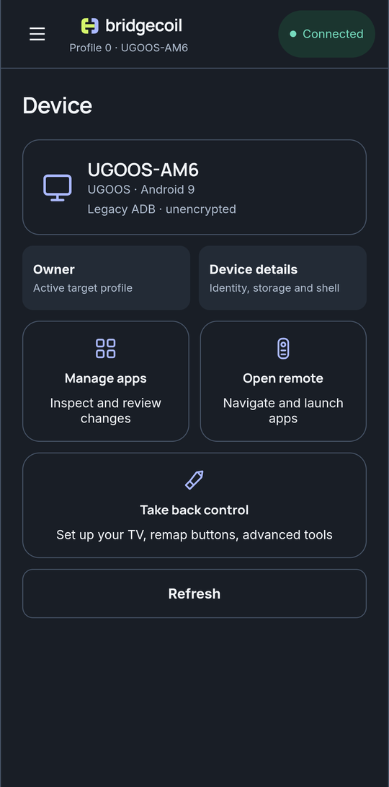

---
hide:
  - navigation
  - toc
---

# Bridgecoil user guide { .md-visually-hidden }

{ .bc-hero__logo }
{ .bc-hero__logo }

## Take back control of your TV

Bridgecoil runs on your phone and manages your Android TV over your home network. Remap your remote, replace the home screen and turn off what you don't use. You review changes to your apps and settings before they run, and you don't need a computer.

[Get started](get-started/index.md){ .md-button .md-button--primary }
[Download Bridgecoil](https://github.com/johnneerdael/bridgecoil/releases/latest){ .md-button }

{ .bc-shot loading=lazy }

## What do you want to do?

-   :material-remote:{ .lg .middle } **Take back your remote**

    ---

    Make a button open the app you want, or act as a different button, and keep it working after a restart.

    [:octicons-arrow-right-24: Your remote](buttons/index.md)

    Popular: [Remap a button](buttons/remap-a-button.md) · [Replace what a button opens](buttons/replace-what-a-button-opens.md)

-   :material-home-outline:{ .lg .middle } **Replace your home screen**

    ---

    Swap the ads and suggestions for Backdrop, Projectivy, Monet, AT4K or a launcher of your own.

    [:octicons-arrow-right-24: Home screen](home-screen/index.md)

    Popular: [Switch launchers](home-screen/replace-your-launcher.md) · [Go back](home-screen/restore-your-launcher.md)

-   :material-broom:{ .lg .middle } **Clean up your TV**

    ---

    Turn off preinstalled apps, guided by a community list of what's safe. Everything can be turned back on.

    [:octicons-arrow-right-24: Clean up](clean-up/index.md)

    Popular: [Clean up your TV](clean-up/clean-up-your-tv.md) · [Bring apps back](clean-up/bring-apps-back.md)

-   :material-apps:{ .lg .middle } **Manage your apps**

    ---

    See every app, what it does and how risky it is to remove. Control permissions and install from a file.

    [:octicons-arrow-right-24: Apps](apps/index.md)

    Popular: [Ratings](apps/ratings.md) · [Install from a file](apps/install-from-a-file.md)

-   :material-gamepad-variant-outline:{ .lg .middle } **Use your phone as a remote**

    ---

    Navigate, control playback and type on the TV with your phone's keyboard.

    [:octicons-arrow-right-24: Remote](remote/use-your-phone-as-a-remote.md)

-   :material-tools:{ .lg .middle } **Go further**

    ---

    Files, screenshots, logs, hidden settings and 42 ready-made commands.

    [:octicons-arrow-right-24: Tools](tools/index.md)

    Popular: [Files](tools/files.md) · [Commands](tools/commands.md)

## Know what's running on your TV

Bridgecoil gives software on your TV a lot of access, and it tells you exactly what. [What Bridgecoil installs](how-it-works/what-gets-installed.md) lists every app and file. [Why it needs this much access](how-it-works/why-it-needs-access.md) explains the risk, and [Remove everything](how-it-works/remove-everything.md) takes it all off.

## New here?

1. [Install Bridgecoil on your phone](get-started/install.md).
2. [Turn on debugging on your TV](get-started/prepare-your-tv.md).
3. [Connect your phone to the TV](get-started/first-connection.md).
4. [Set up your TV](get-started/set-up-your-tv.md).
