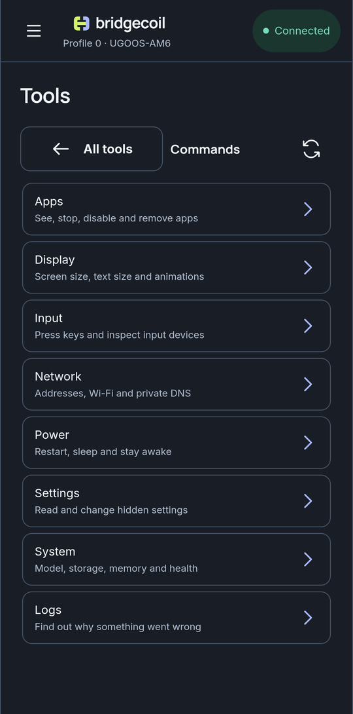

# Run a command without typing

Commands is a list of ready-made actions. Pick one, pick its options, and Bridgecoil builds the command for you.

Open **Tools → Commands** and choose a group. Each command shows a description, a badge and any options.

| Badge | Meaning |
|---|---|
| **Only reads** | Changes nothing |
| **Changes the TV** | Changes something |
| **Be careful** | Can break something or disconnect you. Read the warning |

{ .bc-shot loading=lazy }

!!! screenshot "commands-detail.png"
    A command with its badge, options and This runs on the TV.

**This runs on the TV:** shows the exact command. **Run on the TV** opens a review, and **Save for later** adds it to the top of the list.

The groups are **Apps**, **Display**, **Input**, **Network**, **Power**, **Settings**, **System** and **Logs**. [All commands](../reference/all-commands.md) lists all 42.

## Things to know

Commands run with the same power as [Shell](shell.md). They bypass some of the checks you get elsewhere:

- Unsafe ratings and protected apps aren't checked. **Switch an app off** will disable Settings if you ask it to.
- The result is **Sent**, never Verified. Check the TV.
- There's no automatic undo.

The app-changing commands have safer versions in [Apps](../apps/turn-off-or-remove-an-app.md), which are better for most people.

Saved commands are stored on your phone, so they're available for every TV. If a saved command names an app this TV doesn't have, you'll see "That app isn't on this TV."
