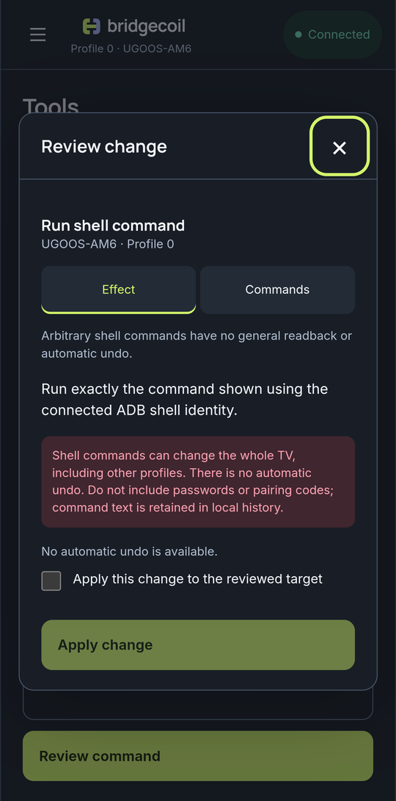

# Run your own command

Type any command and run it on the TV. This is for when you know what you're doing, and there's nothing protecting you here.

Open **Tools → Shell**, type a command and tap **Review command**. The review shows it exactly as it will run. Tick the box and tap **Apply change**.

{ .bc-shot loading=lazy }

The result shows the command followed by its output.

## What's different about Shell

Shell checks nothing about what you type. No command is refused for what it does, and the protections on Unsafe apps, your launcher and system components don't apply. A command can affect the whole TV, including other profiles.

- **No undo.** The review says so.
- **Your commands are saved.** Command text stays in History on your phone, so don't include passwords or pairing codes.
- **Time limit.** A command is stopped after 30 seconds, and output is limited to 1 MB. A timeout drops the connection, so reconnect afterwards.
- **No interaction.** Commands can't ask you questions, and a running command can't be cancelled.
- **Result.** Success shows **Sent**, because Bridgecoil can't know what a command was meant to do.

The command runs as the ADB shell user. See [Why it needs this much access](../how-it-works/why-it-needs-access.md) for what that can do.
