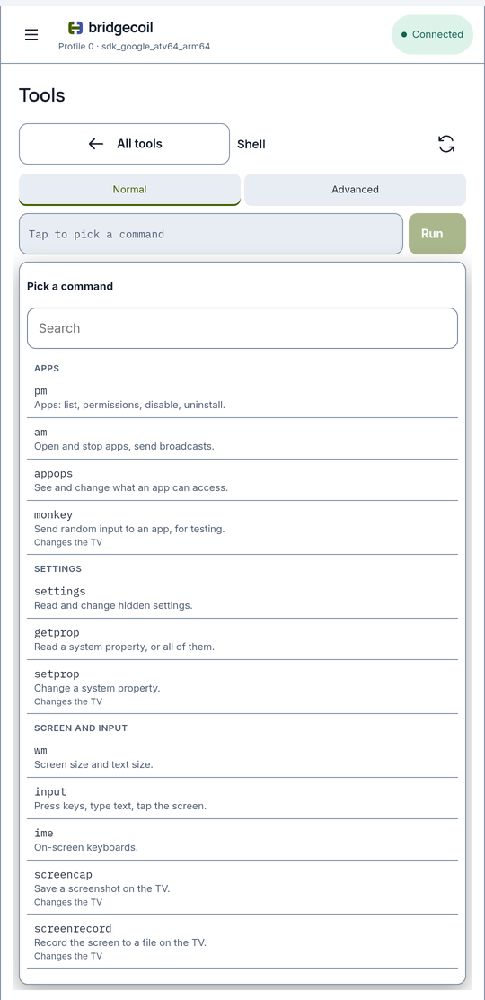
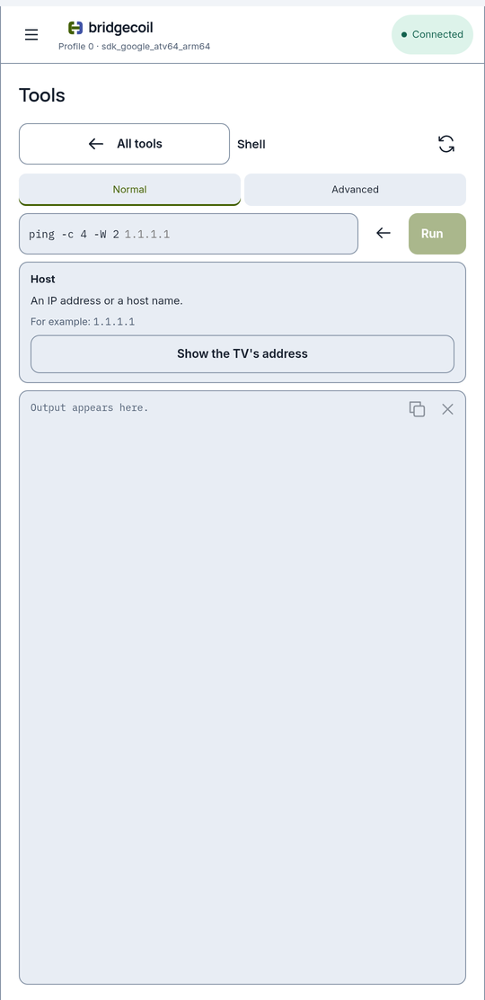
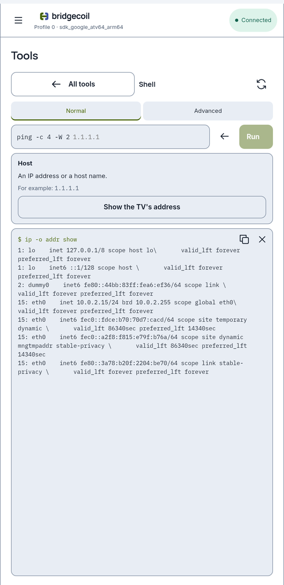

# Run a command on the TV

Build a command one word at a time, with each word explained, or type your own. The result appears in a window underneath.

Open **Tools → Shell**. The page has two modes, **Normal** and **Advanced**, one line for the command and a fixed output window that scrolls. It always opens in **Normal**.

{ .bc-shot loading=lazy }

## Build a command in Normal

You don't need to know any commands in Normal.

1. Tap the line. A dropdown lists every word you can start with, grouped by what it's for, and says what each one does.
2. Pick a word. It goes on the line, and the dropdown changes to the words that can follow it.
3. Keep going until the command is finished. When it could run as it stands, the dropdown shows **Run it now**.

To take a word back, tap the arrow next to the line. Tap the line to hide the dropdown or bring it back. Long lists have a **Search** box.

Words that change something are marked **Changes the TV** or **Be careful**. Anything else only reads. Only commands this TV has are listed, so the list differs between TVs: `media` only appears on older Android, for example.

### Lists come from your TV

Where a word needs something from the TV, the dropdown lists what's there. Bridgecoil reads each list in the background when you get to it, so it's always current.

| The command needs | The dropdown shows |
|---|---|
| An app | Every app on the TV, with names where it has them. `pm enable` lists disabled apps, and `pm uninstall` lists only apps you added |
| A permission | What that app asks for, and whether it has each one |
| A setting | Everything in that group, with its current value |
| A property | Every system property, with its current value |
| A system service | Every service on the TV |
| A file or folder | The TV's folders, which you open as you go |
| A running program, profile, keyboard or network connection | What's on the TV now |
| A key | Every key Android knows, grouped from navigation to channel and colour buttons |

If what you want isn't listed, **Type it myself** lets you enter it.

### When only you know the answer

Some words need something Bridgecoil can't list, such as a web address or a position on the screen. A helper replaces the dropdown. It says what to enter and gives an example. Often it has a button that finds the answer for you. `ping` offers **Show the TV's address**, for example, and the result lands in the output window. Tap **Next word** when more words follow, or **Run** if that was the last one.

{ .bc-shot loading=lazy }

### Narrow down a result

After a command that only reads, the dropdown offers filters: `| grep` keeps lines containing some text, `| grep -v` drops them, `| head -n` and `| tail -n` keep the first or last lines, and `| wc -l` counts them. You can add more than one.

### Commands always finish

Commands here can't ask you anything, and they stop after 30 seconds. Normal mode only builds commands that finish on their own. `logcat` reads the last lines of the log, `ping` sends four packets, `top` runs once, and `getevent` watches the remote for 8 seconds. `ls`, `dumpsys`, `find`, `du` and `traceroute` run under a 25 second `timeout`, which you'll see on the line. If that runs out, the result ends there with exit code 124.

## Type a command in Advanced

**Advanced** is a plain line for when you know the command. Type it and tap **Run**, or press Enter. It runs exactly what you typed, with no help and no checks on what it does. The time limit still applies, so a command that never stops, such as `logcat` without `-d` or a plain `ping`, runs until the connection drops.

## What runs straight away

A command that only reads runs as soon as you tap **Run**. Anything that changes the TV opens the [review](../history/reviews.md) first, showing exactly what will run.

In **Advanced**, a command runs straight away only if Normal could have built it as a read. Anything else gets the review, including any command with `;`, `|`, `>`, quotes or `$` in it, because Bridgecoil can't tell what those do.

Either way, the result lands in the output window and in History.

## The output window

Each command's result stays in the window, newest at the bottom, and the window jumps to the start of the new result.

{ .bc-shot loading=lazy }

- Tap a `$` line to put that command in **Advanced** so you can edit it and run it again.
- The two buttons in the corner copy everything and clear the window.
- If a command fails, you see its output and its exit code.
- Only the first 1 MB of a result is shown, and a note says so. The command still runs to the end.
- The window keeps about the most recent 4 MB of results, and stays filled while the app is open, even if you visit another page. Closing the app empties it. History keeps each result.

## Run something inside Termux

If Termux is on the TV and Bridgecoil can reach it, Normal has a `termux` word. Its commands run as Termux rather than as the TV's shell:

- **Packages**: `pkg list-installed`, `pkg list-all`, `pkg search`, `pkg show`, `pkg install`, `pkg uninstall`, `pkg update`, `pkg upgrade` and `pkg autoclean`.
- **Files and scripts**: list Termux's home folder and boot scripts, show a file, run a script with `bash`, make one executable with `chmod +x`, or delete a file with `rm`.
- **About Termux**: `termux-info`, `uname -a`, `df -h` and the size of its home folder.

Package installs can take much longer than 30 seconds, so `pkg install`, `pkg uninstall`, `pkg update` and `pkg upgrade` start in the background and return straight away. **Show the install log** shows how the last one went. Removing core packages can stop your [button mappings](../buttons/index.md), and the warning says so.

!!! note "What the line shows for Termux"
    The line shows the short form, such as `termux termux-info`. The real command is much longer, because `run-as` has to set up Termux's environment. The review and the output window show it in full.

## What Shell can't do

- **Commands for a computer.** `adb install`, `adb push`, `adb pull`, `adb backup`, `adb connect` and `fastboot` run on a computer, so they aren't here. Use [Install app](../apps/install-from-a-file.md) and [Files](files.md) instead. On the TV, `adb reboot` is just `reboot`, and `adb shell pm list packages` is just `pm list packages`.
- **Interactive programs.** `vi`, `nano` and a bare `sh` wait for input, so they don't work.
- **Root.** Commands run as the `shell` user. [Why it needs this much access](../how-it-works/why-it-needs-access.md) covers what that can and can't do.
- **Cancelling.** A running command can't be stopped. After 30 seconds the connection drops, and you'll need to reconnect.

## Be careful with what you run

Shell checks nothing about what a command does. The protections on Unsafe apps, your launcher and system components don't apply here, and a command can affect the whole TV, including other profiles. There's no undo.

Command text and output are saved in History on your phone, up to 64 KB each, so don't include passwords or pairing codes.

A successful command that changes something shows no **Verified**, because Bridgecoil can't know what it was meant to do. It shows the output instead.
